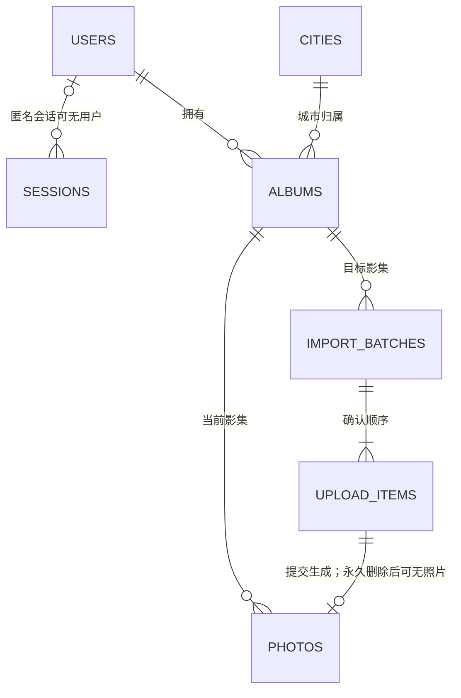

# 此间集数据与接口契约

更新：2026-11-07。本文只描述当前实现；结构以[模型](../../backend/src/city_memories/models.py)与[迁移链](../../backend/migrations/versions/c7e9a162b4d8_add_album_cover_preference.py)为准，HTTP schema 由[路由](../../backend/src/city_memories/main.py)生成 OpenAPI。运行结构和地图来源见[技术架构](tech-stack.md)，操作步骤见[功能指南](../guides/user-guide.md)。

第一版各任务与第二版子项的验证保留在[报告索引](../reports/README.md)，不在契约中重复测试条数。V2-04、第二版整体验收与 T17 仍待安排。

## 1. 数据模型与约束

内部业务 ID 为 UUID，数据库时间保存 UTC Unix 毫秒整数。API 中用户/影集创建更新时间、导入批次 expires_at 输出 UTC ISO 8601 字符串；回收站 deleted_at、purge_after、server_time 输出 Unix 毫秒整数，remaining_ms 为剩余毫秒。不能按同一种时间格式解析全部接口。



| 表 | 职责与关键字段 |
| --- | --- |
| users | username / 唯一 username_key、password_hash、创建时间 |
| sessions | token_hash、可空 user_id、csrf_token、有效/撤销时间；不存原始会话标识 |
| auth_rate_limits | scope、HMAC key_hash、固定窗口与计数，不存明文凭据 |
| cities | 稳定 id、provider / provider_code、名称/上级/单位类型、审核与启用状态；无几何或私人统计 |
| albums | owner_id、city_id、year、revision、created_at / updated_at、preferred_cover_photo_id |
| import_batches | owner_id、album_id、request_key / request_hash、state / expires_at、提交摘要与收据 |
| upload_items | batch_id / owner_id、item_index、有序文件声明、storage_key、reserved_photo_id、状态/尝试/租约与实测资料 |
| photos | owner_id、album_id、upload_item_id、storage_key、原名/格式/字节/哈希/尺寸、position / note、state / revision、删除与到期时间 |

当前迁移头为 `c7e9a162b4d8`，封面偏好允许 null。城市相册是年份影集的只读聚合，不另建表。

- 同一账号、城市、年份仅一份影集；year 为严格整数 1–9999 或 null，两个部分唯一索引分别约束具体年份和未标年份。
- 照片与影集、上传与批次使用带 owner_id 的复合外键，接口仍须单独授权。停用城市的既有影集可由本人读取，新建返回 CITY_UNAVAILABLE。
- active 照片的影集/position 唯一，回收站 position=null。position 可以有间隔，详情 ordinal 才是从 1 起的序号。
- 哈希不唯一，重复默认全部保留，每份有独立 ID、文字与副本。数据库不保存图片 BLOB、源绝对路径或永久公开原图 URL；storage_key 仅服务端使用。
- reserved_photo_id 不是指向 photos 的外键：上传前预留，永久删除后仍保留在幂等元数据中，重放不能重建照片。
- 照片数/点亮仅统计 active；影集数包含空影集。移动或删空后影集保留，恢复/移入追加目标末尾。

## 2. HTTP 通用约定

前缀 `/api/v1`，同源 Cookie 会话。除健康检查及登录前认证流程外，业务接口需要登录；客户端 owner_id 不作为授权依据。普通成功 JSON 为 `{"data": ...}`，错误为 `{"error":{"code":"...","message":"...","request_id":"..."}}`；原图直接返回二进制，204 没有 JSON 正文。

私人 JSON 和原图采用 `Cache-Control: private, no-store`。响应不输出密码/会话摘要、私有路径、存储键或完整内容哈希。修改请求携带会话 Cookie、可信 Origin/Referer 和 `X-CSRF-Token`，含登录、注册、上传、退出。

| HTTP | 主要含义 |
| --- | --- |
| 401 / 404 | 未登录；或已登录但资源不存在/非本人（统一 404） |
| 403 / 409 | CSRF/来源不符；版本、状态或幂等参数冲突 |
| 410 | 导入过期、本人回收站照片到期或正在清理 |
| 413 / 415 / 422 | 请求过大、格式不支持、字段/文件/游标无效 |
| 429 / 503 | 限流（含 Retry-After）；临时存储不可用 |

一般分页默认 24，limit 为 1–100，返回 items / next_cursor，null 表示结束。游标是服务端签名的不透明值，不能改写、跨条件或跨 scope 使用：

| 列表 | 游标边界 |
| --- | --- |
| 城市目录 | 视图与规范化查询词；公共目录不绑定账号 |
| 本人年份影集、城市相册、城市内年份 | 账号及相应筛选/排序/城市范围；不是 revision 快照，新增后可能需刷新首批 |
| 照片、重复分组 | 账号、影集及影集 revision；变化返回 409 / ALBUM_CHANGED |
| 回收站 | 账号、未到期 ID/版本摘要；成员或期限变化返回 409 / TRASH_CHANGED |
| 导入队列 | 单独使用 after / next_index，每页最多 25 批，见第 6 节 |

## 3. 注册与会话

| 方法与路径 | 请求 | 成功 data |
| --- | --- | --- |
| GET /auth/csrf | 无有效会话时签发匿名会话 | {csrf_token} |
| POST /auth/register | {username, password, password_confirm} | 201，UserView；注册后仍需登录 |
| POST /auth/login | {username, password} | {user: UserView, csrf_token}，轮换会话 Cookie |
| GET /auth/me | 当前会话 | UserView |
| POST /auth/logout | 撤销当前会话 | 204 |

UserView 为 `id, username, created_at`。用户名为 3–32 位英文字母、数字或下划线，唯一键转小写。新注册的密码和确认密码均为 8–16 个字符，仅允许可见 ASCII（`!` 至 `~`），拒绝中文、空格、emoji、全角及控制字符；确认密码不入库。前后端使用相同的有限常见弱密码表，按完整密码忽略大小写比对，不要求字符种类混合；实际密码不转换大小写、不 trim、不删除字符、不截断。长度、字符、常见弱密码和两次不一致分别返回固定错误代码与提示，不回显输入或校验异常。

登录接受 8–128 个 Unicode 码点，继续支持已有中文、空格、长密码和旧规则密码；不对登录套用注册字符或弱密码限制。错误凭据统一为账号或密码不正确。已有密码哈希不重置、不迁移，本轮没有修改/找回密码接口。注册/登录的显隐按钮仅改变输入框显示，保留粘贴、自动填充及密码管理器支持；切换入口恢复隐藏并清除密码。交付证据见[账号密码规则与输入体验](../reports/v2/2026-11-07-account-password.md)。

匿名会话 1 小时，登录会话绝对有效期 7 天；登录撤销旧会话，退出/过期立即拒绝旧凭据。CSRF Token 在同一会话内稳定，避免多窗口互相失效。凭据不进入 URL 或日志；来源头只按可信部署配置处理，本地启动禁用代理来源头。

当前固定窗口：同账号 15 分钟最多 10 次失败，同来源 15 分钟最多 60 次登录尝试，注册每来源每小时 5 次，匿名会话新签发每来源每小时 60 次（复用不计）。认证 JSON 实际上限 16 KiB。退出/换号清空前端私人状态和 Blob 地址，取消请求并拒绝晚到响应。

认证前端为登录、注册、退出及各次状态核对设置 15 秒整体等待期限，含 CSRF 准备、响应头和正文。超时/取消等待不会回滚服务端操作；网络、5xx 或无效成功响应进入结果不明状态，不自动重放 POST。登录核对按 `/auth/csrf` → `/auth/me` 读取当前令牌与身份，匹配原提交用户名后才进入；401 仅说明当前浏览器没有有效登录态。注册结果不明只带用户名转登录，不回显“账号已创建”，不新增公开的账号存在查询。

退出开始立即隐藏私人页，初次提交与显式重试均先核对当前身份及 CSRF；核对到其他账号时不替其退出。退出成功或核对当前已无登录态后才完成；其余情况保留核对和明确重试入口。退出未确认期间恢复页面、切回窗口或跨窗口通知不能重新显示旧私人内容。实现与验证见[认证等待与恢复](../reports/v2/2026-11-07-auth-recovery.md)。

## 4. 城市、年份影集与封面

CityView 为 `id, name, parent_name, unit_kind, can_create`；AlbumView 为 `id, city, year, revision, photo_count, cover_photo_id, original_url, created_at, updated_at`，其中 city 是嵌套 CityView。

| 方法与路径 | 输入 | 成功 data |
| --- | --- | --- |
| GET /cities | q、view、cursor、limit | {items: CityView[], next_cursor} |
| GET /me/atlas | 无 | {items, album_count, photo_count}；每项 {city, album_count, photo_count, lit} |
| GET /me/city-albums | q、year、sort、cursor、limit | 城市相册聚合分页，见下文 |
| GET /me/albums | q、year、sort、cursor、limit | 本人年份影集分页，items 为 AlbumView |
| GET /me/albums/options | 无 | {years}；本人全部具体年份倒序，null 最后，不受当前搜索/分页影响 |
| GET /cities/{city_id}/albums | cursor、limit | {city, items: AlbumView[], next_cursor}，年份倒序、null 最后 |
| POST /cities/{city_id}/albums | {year}，必填，可 null | 201：AlbumView + created=true；已有同年份为 200 + created=false |
| GET /albums/{album_id} | 无 | AlbumView |
| PATCH /albums/{album_id}/cover | {photo_id, expected_revision}，photo_id 可 null | AlbumView；null 恢复自动封面 |

创建、封面输入不接受额外字段，版本为正的严格整数。已有影集创建不覆盖内容；非本人照片不能设封面。手选封面失效时回退第一张 active 照片，无 active 时封面及 URL 均 null；封面偏好变化仅增加影集 revision，无变化不增加。

### 城市目录视图

q 最多 80 字符，trim 后按城市名或所属地区字面包含匹配。view 为 all（默认）或 province-centers，其他值 422；均只列 active 且 verified，当前 391 个开放入口，草湖市待映射，见[审核目录](../reference/t13-city-catalog.md)。

all 按名称/ID 升序；province-centers 由[明确 UUID 与拼音键](../../backend/src/city_memories/province_centers.py)选出 34 个省级地区对应城市，台湾地区选台北，不猜代码/名称后缀。先筛选排序再分页；首页空搜索使用该视图、limit=100，非空搜索查 all。城市目录与地图完整目录不因默认入口改变而缩减。

### 城市相册聚合与筛选

`/me/city-albums` 按本人年份影集先聚合城市再分页，包含只有空影集及停用后保留的历史城市。每项为 `city, album_count, photo_count, latest_year, has_unmarked, cover_photo_id, original_url`；latest_year 是全部影集的最大具体年份，只有未标年份时 null。

year 省略为全部，或为 unmarked / 1–9999 无前导零数字字符串；筛出存在该年影集的城市，**统计、最新年份与封面仍覆盖该城市全部年份**。q 同上；sort 默认 year（最大年份降序/城市 ID 升序），recent 按城市内影集最新 updated_at 降序/城市 ID 升序。

城市封面选年份倒序、null 最后首个有 active 照片的影集，再用该影集手选/自动规则；较新空年份不遮住较早有照片年份。不新增城市手选封面，也不改变年份偏好。

`/me/albums` 保留年份影集语义：q / year 筛选各影集，sort 为 year 或 recent。首页最近整理使用 recent；文字保存不更新影集时间，创建、导入、移动、排序、回收/恢复及封面变化会更新。两种列表游标不能互换，城市聚合响应不另加 updated_at。

## 5. 照片浏览、文字与重复查看

PhotoView 为 `id, album_id, original_filename, mime_type, byte_size, width, height, position, revision, has_note, original_url`；列表无 note 全文、完整哈希或私有路径。原图 URL 是同源鉴权地址，不含凭据或源盘符。

| 方法与路径 | 输入 | 成功 data / 行为 |
| --- | --- | --- |
| GET /albums/{album_id}/photos | cursor、limit | {items: PhotoView[], next_cursor, album_revision, photo_count}，按 position/ID 升序 |
| GET /photos/{photo_id} | 可选 album_id、expected_album_revision | PhotoView + note、album_revision、previous_photo_id、next_photo_id、ordinal、photo_count |
| GET /photos/{photo_id}/original | 无 | 仅本人 active 原字节，MIME 来自服务端校验 |
| PATCH /photos/{photo_id}/note | {note, expected_photo_revision} | {id, album_id, note, revision, has_note} |
| GET /albums/{album_id}/duplicates | cursor、limit | {items, next_cursor, album_revision, group_count, photo_count} |

详情前后 ID 和 ordinal 来自完整 active 影集，首/末邻接为 null，不受已加载分页限制。可选浏览上下文改变返回 409，照片不属于本人先返回 404。资料与统计在同一读取快照取得。

note 为原样纯文本，最多 2000 Unicode 码点，允许空白、换行和空字符串；孤立代理字符 422。JSON 实际上限 64 KiB，版本正严格整数，不接受额外字段。变化只增加照片 revision，相同文字不增版本，不改原图或影集顺序。

重复仅比较本人同影集 active 文件 SHA256，不按文件名或相似画面。每组 `{group_id, total, photos: PhotoView[]}`，group_id 是组内最小照片 UUID，不是哈希或永久实体；group_count 为全部重复组数，photo_count 包含每组第一份。limit 按**照片份数**限制，大组可跨页，由前端按 group_id 合并；按 group_id / position / ID 排序。关闭页面默认全部保留，删除其中一份不影响其他副本。

## 6. 导入协议与失败恢复

统一添加入口先核对年份/顺序、确认队列，再上传及保存；旧 `?import=` 只恢复既有单批任务。城市入口按确认年份分组，每批最多 400 项，同影集批次按顺序提交；不同影集独立报告，不承诺跨影集全有或全无。进入明确年份时，文件名识别不静默改变归属；导入路径 album_id 已固定目标，正文不接受 year。

| 方法与路径 | 输入 | 结果 |
| --- | --- | --- |
| POST /albums/{album_id}/imports | Idempotency-Key 头；{items:[{original_filename, byte_size, sha256}]} | 首次 201，同键同内容重放 200；data 为 BatchView |
| PUT /imports/{batch_id}/items/{item_id}/content | 单个 multipart file，无文本字段 | ItemView；staged 重放直接返回原项 |
| GET /imports/{batch_id} | 无 | BatchView；过期返回 410 |
| GET /imports/queue/{queue_id} | after 默认 -1 | {items, next_index}，每页最多 25 批 |
| POST /imports/{batch_id}/commit | {expected_album_revision, allow_partial:false} | Receipt，原参数重放返回原收据 |
| DELETE /imports/{batch_id} | 取消未提交批次 | 204；不删除已提交照片 |

BatchView 为 `id, album_id, album_revision, state, expires_at, items, result`；ItemView 为 `id, item_index, original_filename, byte_size, state, failure_code`；Receipt 为 `batch_id, album_id, photo_ids, failed_item_ids, album_revision`。未提交 result=null，已提交返回保存的 Receipt。批次 album_revision 是查询时当前值，收据版本是保存时值，可能不同。

### 文件与接收限制

每批 1–400 项；Idempotency-Key 为 1–128 位英文字母/数字/下划线/连字符，sha256 为 64 位小写十六进制，byte_size 是 1–50 MiB 严格整数。original_filename 长度 1–255，不可含路径分隔符、盘符或控制字符，不用于磁盘寻址。创建 JSON 上限 1 MiB、提交 16 KiB；实际 multipart 不超过声明字节 +64 KiB，部件头累计最多 16 KiB。

支持 JPEG、PNG、静态 WebP，最多 8000 万像素；服务端自行核对实际大小/哈希/格式并完整解码，不重编码。全局及同批最多两路接收/解析，超限 429。15 分钟租约及随机尝试标识保护发布，旧尝试不能覆盖新尝试；接收等待超出租约为 UPLOAD_ATTEMPT_EXPIRED。

上传项 `pending → receiving → staged → committed`，失败为 failed，可重传；取消/到期的未提交项 discarded。批次 open / committed / canceled / expired，未提交 open 24 小时到期。启动将中断的 receiving 标为 failed / INTERRUPTED；不提供文件内断点续传或后台扫描源盘。

### 提交、幂等与查询恢复

提交先核对本人、状态、版本与文件，再按 item_index 追加到完整影集末尾，照片/上传项/批次收据和影集版本同事务保存。暂存或上传 100% 不代表已加入影集。文件可能先于数据库发布，提交失败时受保护的副本留供同批重试，不能直接清空暂存目录。

默认全部 staged 且无 receiving 才能保存。只有用户明确选择部分保存才传 allow_partial=true，此时也不得有 receiving；未保存项 discarded，之后重选的新批次追加末尾，不插回已保存顺序。

创建摘要包含影集与有序文件资料，同账号同键改内容/顺序/影集返回 IDEMPOTENCY_CONFLICT；过期创建重放也可能 410。commit 摘要包含规范化 expected_album_revision / allow_partial；已提交时原参数返回原收据，改参数 COMMIT_CONFLICT，不先用当前影集版本否定原成功重放。收据在移动、回收或永久清除照片后仍保留，重放不会重建/移回照片；已提交批次不可取消。

队列为随机 UUID，键为 `<UUID>_<六位批次序号>`；after 范围 -1–999999，next_index 是最后批次序号，不是 offset。每项在 BatchView 上增加 queue_index / city_id / year；查询只读本人匹配键，其他账号返回空列表。队列特意保留 expired 项供显式清理，单批 GET 的 410 规则不变。

响应丢失先查原批/队列并按原标识和参数重试；刷新只恢复服务端已有记录，本地核对草稿与尚未完成文件需重选。同名同大小多项有歧义时逐行匹配，服务端最终核对冻结哈希。照片、文件名清单和哈希不写浏览器持久存储。

## 7. 排序与跨影集移动

| 方法与路径 | 严格请求字段 | 成功 data |
| --- | --- | --- |
| POST /albums/{album_id}/reorder | photo_id、before_photo_id（必填，可 null）、expected_album_revision | {album_id, photo_id, before_photo_id, album_revision, changed} |
| POST /photos/{photo_id}/move | target_album_id、expected_photo_revision、expected_source_revision、expected_target_revision | {photo, source_album_id, source_revision, target_album_id, target_revision, target_duplicate_count} |

版本为正的严格整数，JSON 上限 16 KiB，不接受额外字段。SQLite 先取得写锁再读归属/版本；排序操作完整 active 影集，before_photo_id=null 表示末尾。两阶段位移和最终顺序同事务，任一步失败全部回滚；无变化 changed=false、版本不增，纯排序不改照片 revision。

移动只允许本人 active 照片及本人源/目标影集，追加目标最大 position+1（空为 0），照片与两影集 revision 各加一；保留 ID、原名、原字节、文字、上传关联及收据。不同版本分别返回 PHOTO_CHANGED / SOURCE_CHANGED / TARGET_CHANGED，同影集返回 SAME_ALBUM。新目标先显式创建，取消移动不撤销已建空影集。

target_duplicate_count 无同内容为 0，否则为移入后全部份数，仅提示。编辑/移动不生成导入式收据；冲突或结果不明先查询当前位置/最新版本，不自动重放，不覆盖新修改。未保存文字留在内存并有离开提醒，退出/换号优先清理。

## 8. 回收站与恢复

| 方法与路径 | 请求 | 成功 data / 行为 |
| --- | --- | --- |
| POST /photos/{photo_id}/trash | {expected_photo_revision, expected_album_revision} | TrashDetail（含 note） |
| GET /trash/photos | cursor、limit | {items: TrashView[], next_cursor, photo_count, server_time} |
| GET /trash/photos/{photo_id} | 无 | TrashDetail |
| GET /trash/photos/{photo_id}/original | 无 | 本人未到期回收站原字节 |
| POST /trash/photos/{photo_id}/restore | {expected_photo_revision, expected_album_revision} | {photo, album_revision, duplicate_count} |

TrashView 为 `id, album_id, city, year, original_filename, mime_type, byte_size, width, height, revision, album_revision, has_note, deleted_at, purge_after, remaining_ms, original_url`；详情再加 note，列表无全文。时间为毫秒整数（见第 1 节），详情没有 server_time 字段。

删除 `active → trashed`、position=null，purge_after=删除时间+30×24 小时；照片/影集 revision 各加一。恢复须严格早于到期，先核对原图存在与大小，再追加原影集末尾，清空删除期限，原 ID/字节/文字不变；再次删除重新起算期限。duplicate_count 无重复为 0，否则为恢复后同内容全部份数，不合并。

回收站只列本人未到期 trashed，按 deleted_at 降序、ID 升序。到期相等也立即拒绝详情/原图/恢复（410 TRASH_EXPIRED），即使物理文件还在；purging 同样不可恢复。照片非回收状态为 PHOTO_NOT_TRASHED，版本冲突为 PHOTO_CHANGED / ALBUM_CHANGED；原图不可用 503 且不改状态。有效原图与回收站地址不能跨状态读取。

回收站与 pending 上传仍占空间，但不计 active 照片或点亮。结果不明先“核对当前状态”，不重复删除/延长期限；前端按服务器剩余时长和单调时钟倒计时，到期卸载原图和恢复入口。

## 9. 物理清理与离线备份

这些是本地维护能力，没有永久删除按钮或备份 HTTP 接口；配置见[后端说明](../../backend/README.md#t10-到期清理及故障恢复)，操作见[备份说明](../guides/backup-restore.md)。

清理先短事务置 purging，再删该份独有副本，成功或文件已不存在后删 photos 行；失败保留进度重试。与恢复条件更新竞争，受操作系统实例锁及导入发布锁协调。启动补做，后台每轮结束后默认等待 60 秒；停机或故障不保证第 30 天准时物理删除，但访问期限立即生效。

每轮最多标记 100 到期照片、处理 100 purging、100 过期批次、200 关闭批次项、200 过期接收租约；每个私有文件目录轮转核对最多 200 项，但目录名仍完整枚举排序。有效租约、未到期 staged 及失败后提前发布副本受保护，无元数据系统文件需满 24 小时才回收。未知命名/目录不处理，拒绝链接/重定向，不递归或接收源路径。会话与限流分别最多清除 500 条，日志仅汇总计数；导入收据不清除。

备份工具 `python -m city_memories.backup create/verify/restore` 要求先正常停后端，全程持有同一实例锁，以 SQLite Backup API 快照配合原图形成格式 v1。清单包含迁移版本、快照时间、表计数、逐照片身份/归属/期限/哈希及元数据摘要；留在私人备份，不输出公开日志。验证目录成员、schema、完整性/外键、关系和逐文件字节；哈希不是签名，仅接受本人掌管的可信备份。

快照保留 active 与未到期 trashed，排除 purging/过期照片、sessions、限流记录、暂存和认证密钥；关闭未完成导入，保留已提交项/收据。只清理副本并 VACUUM，不改源库。恢复写工作区外全新目录，禁止覆盖/合并/嵌套/链接；完成前再次核对原期限，不重置回收站 30 天，旧会话失效，原账号密码保留。

当前支持 schema `b61e24f803a7` 与 `c7e9a162b4d8`，按原版本恢复，不自动迁移未知版本。失败留下 .maintenance-incomplete，禁止应用/迁移启动；完整备份目录也不能当运行目录。不内置加密、自动备份或轮换；历史备份的删除按介质保留策略处理，在线清除不承诺擦除全部历史副本。

## 10. 地图与健康接口

| 方法与路径 | 成功 data | 当前用途 |
| --- | --- | --- |
| GET /health | {status:"ok"} | 不要求登录，探测数据库连接 |
| GET /map/cities | MapCity[] 数组 | 登录；CityView + provider_code，公共业务目录，无几何或私人统计 |
| GET /map/config | {enabled, key, review_number, review_date, catalog_version, message} | 登录且同源；仅第一版兼容，配置不可用时 key=null |
| GET /me/atlas | 见第 4 节 | 本人统计，独立于公共地图几何 |

当前地图从同源 `/map-data/china-cities.v1.json` 加载固定公共几何，与 /map/cities 严格核对，私人点亮来自 /me/atlas；不请求 /map/config、世界瓦片或在线逐市边界，无需地图 Key。旧兼容接口中浏览器 Key 也不能视为对浏览器保密。稳定 UUID 始终用于路由/影集关联，外部新目录不能绕过审核门禁。

## 11. 请求与响应示例

以下为虚构 UUID / 城市 / 时间，用于展示 schema，不是实际账号或接口运行结果。修改请求仍须有效 Cookie、可信来源及 CSRF，不在示例中放凭据。

### 创建未标年份影集

`POST /api/v1/cities/00000000-0000-4000-8000-000000000001/albums`，请求 CreateAlbum：

```json
{"year": null}
```

201 响应 Envelope[CreatedAlbum]，已有返回 200 且 created=false：

```json
{
  "data": {
    "id": "00000000-0000-4000-8000-000000000002",
    "city": {
      "id": "00000000-0000-4000-8000-000000000001",
      "name": "示例市",
      "parent_name": "示例省",
      "unit_kind": "prefecture",
      "can_create": true
    },
    "year": null,
    "revision": 1,
    "photo_count": 0,
    "cover_photo_id": null,
    "original_url": null,
    "created_at": "2026-11-06T00:00:00Z",
    "updated_at": "2026-11-06T00:00:00Z",
    "created": true
  }
}
```

### 把照片放到影集末尾

`POST /api/v1/albums/00000000-0000-4000-8000-000000000002/reorder`，请求 ReorderInput：

```json
{"photo_id":"00000000-0000-4000-8000-000000000003","before_photo_id":null,"expected_album_revision":4}
```

200 响应 Envelope[OrderView]，无变化时 changed=false 且保留原版本：

```json
{"data":{"album_id":"00000000-0000-4000-8000-000000000002","photo_id":"00000000-0000-4000-8000-000000000003","before_photo_id":null,"album_revision":5,"changed":true}}
```

版本冲突为 409，先核对最新结果再由用户确认：

```json
{"error":{"code":"ALBUM_CHANGED","message":"影集已更新，请刷新后重试","request_id":"example-request"}}
```
