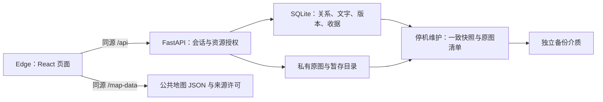

# 此间集技术架构与地图

更新：2026-11-06。本文描述当前实现；字段和失败协议见[数据与接口契约](data-api-design.md)，安装与命令见[本地手册](../guides/local-first-release.md)。第一版在线地图选型与实测留在 [T12](../reports/v1/t12-map-data-loading.md)、[T13](../reports/v1/t13-map-verification.md)，不作为第二版运行方式。

T01–T16 和第二版已交付子项可用；V2-04、第二版整体验收与 T17 部署仍待安排，以[开发计划](../planning/development-plan.md)为准。初期面向本人和朋友、10 人以内，这是产品定位，不是容量或并发保证。

## 1. 组件与职责

| 部分 | 当前方案 | 职责与约束 |
| --- | --- | --- |
| 前端 | React 19、TypeScript、Vite、React Router | 城市地图、城市相册、年份影集与照片页面；原生 CSS，灰绿与白色界面 |
| 请求与状态 | 原生 fetch / XHR、集中 API 模块、页面及账号内存状态 | XHR 提供上传字节进度；统一错误、401、取消与晚到响应处理；私人列表、草稿和原图不写浏览器持久存储 |
| 后端 | Python 3.13、FastAPI、Pydantic、Uvicorn | 会话、授权、导入、编辑、鉴权原图与维护协调 |
| 关系数据 | SQLAlchemy 2、Alembic、SQLite WAL | 账号、城市映射、年份影集、照片元数据、版本与幂等收据 |
| 原图 | 私有 originals / staging 目录、Pillow 校验 | 保存独立原字节副本，不重编码、不生成缩略图 |
| 地图 | 随应用分发的公共 JSON、SVG | 391 个已审核入口、本人填色、省界/市界、搜索定位与键盘操作；当前页面不需要地图 Key |
| 验证 | pytest、Playwright 与实际 Edge、离线地图规则、规模工具 | 使用隔离数据；历史结果见[报告索引](../reports/README.md)，工具见[验证索引](../../validation/README.md) |

依赖由 npm / uv 和已有锁文件管理，准确版本见[前端清单](../../frontend/package.json)、[后端清单](../../backend/pyproject.toml)。不因本文整理升级依赖。

## 2. 运行结构与入口

本机前端固定在 `127.0.0.1:5173`，`/api` 代理到 `127.0.0.1:8000`。PyCharm 共享配置或两个终端任选一种启动；前端 `npm run start:local` 提供已构建的 dist，更新前端后须重新构建。开发模式与构建预览不能同时占用同一端口。具体步骤见[软件启动指南](../guides/ide-startup.md)。

根目录 `.env` 提供本地配置，默认私人目录为 `.local-data/`，也可使用配置指定的目录；数据库、原图和认证密钥都在公开静态目录之外。技术标识仍沿用 `city_memories`、`CITY_MEMORIES_` 等，产品改名无需迁移资料，见[兼容约定](../reports/maintenance/maintenance-log.md#2026-11-06-产品改名)。

同一数据目录以操作系统锁强制单应用实例，关闭定时清理也不允许第二个实例。数据库放本机持久磁盘，不使用多 worker、网络共享库或同步盘作为运行目录。应用启动会补做清理，维护前先正常停止后端；迁移与备份也遵守实例锁。

T17 再安排同域 HTTPS、反向代理、跨电脑访问、实际带宽/容量和独立备份策略。Vite 预览不是公网生产服务器，当前没有公开部署。

## 3. 数据关系与并发修改

页面按“城市相册 → 年份影集 → 照片”组织。数据库的 `albums` 仍是一城一年的年份影集；城市相册是本人年份影集的只读聚合，不增加表。城市使用稳定业务 UUID，外部行政编码仅作映射，不能直接作为私人资料归属。

SQLite 启用外键、WAL 与锁等待；每次请求使用独立会话，文件接收/解码不占用长写事务。年份与未标年份使用两个部分唯一索引。排序、移动、删除和恢复在短事务内校验版本，再一次提交相关关系和版本变化。

照片 ID、原图字节、文字和顺序分开保存。文字变化只增加照片 revision；纯排序只增加影集 revision。排序读取完整影集，临时位移和最终位置写入同一事务，兼容删除或移走后留下的稀疏位置。版本冲突或响应不明先查询核对，编辑操作不自动重放。

当前单实例方案已有 [T15 规模与双账号验证](../reports/v1/t15-scale-verification.md)，但不据此承诺任意并发或长期内存表现。若实测持续写锁等待或需要多实例，再评估数据库和部署方案；不能只换连接地址就视为完成迁移。

## 4. 账号与私人访问

密码使用 Argon2 哈希；会话为服务端可撤销记录，数据库只存会话标识摘要，浏览器使用 HttpOnly Cookie。登录轮换会话，退出与到期立即失效。修改请求校验可信来源与 CSRF，包括注册、登录、上传及退出；本机启动禁用代理来源头。

所有私人资源按当前会话账号授权，不相信客户端 owner_id。非本人资源与不存在资源均返回 404；私人 JSON 和鉴权原图采用 `private, no-store`。原图目录不作为静态目录暴露。

退出/换号取消在途请求、清空私人状态并释放 Blob URL；身份版本检查拒绝晚到响应。未保存文字使用路由离开和关页提醒，草稿只在内存保留。已主动下载的文件不受退出控制。

## 5. 原图导入、浏览与恢复

当前“添加照片”统一接收单张、多张和拖入，先核对年份与顺序，再确认队列、上传、保存。旧 `?import=` 入口仅用于恢复既有单批任务。城市入口按确认年份分组，各影集独立报告；同影集顺序提交，每批最多 400 项，不是账号容量上限。

每张最多 50 MiB / 8000 万像素，支持 JPEG、PNG、静态 WebP。服务端限制实际请求体，逐块写入并自行核对格式、尺寸、字节与 SHA256；Pillow 只校验/解码，不重存图片。两路接收及 15 分钟租约限制并发，24 小时未提交批次过期。

暂存成功不等于加入影集。整批按确认顺序提交；部分保存必须由用户明确选择。原请求标识和参数支持重试/查询，已提交收据在照片永久删除后仍保留，重放不会复活或移回照片。文件与数据库不是天然原子事务，提前发布副本与中断租约由受保护的重试和清理流程处理。

照片资料默认每页 24 条，图像只在视野附近加载，同页最多两路原图传输；查看层只读当前一张并暂停列表图片。离开范围、关闭查看或换号时中止请求、断开图像并撤销 Blob URL。分页不等于限制了解码内存。

跨影集移动保留 ID、原图和文字，追加到目标末尾；完全重复只按本人同影集 active 照片 SHA256 分组，默认全部保留。删除进入 30×24 小时回收站，恢复到原影集末尾；空影集保留，到期立即拒绝读取/恢复。状态、版本和分页细节集中在[接口契约](data-api-design.md)。

启动补做一轮清理，运行期间每轮完成后默认等待 60 秒；先落库 purging，再删该份文件，最后删照片行，失败保留进度重试。清理数量有界，但目录名仍完整枚举，不代表任意积压性能已测。只操作经过校验的系统副本，不扫描或删除源盘文件。

离线备份须停后端，工具持有同一实例锁，以 SQLite Backup API 快照配合有效及未到期回收站原图生成校验清单。恢复只写工作区外全新目录，不覆盖或合并；旧会话失效，原期限不重置。当前兼容迁移 `b61e24f803a7` 与 `c7e9a162b4d8`，按备份原版本恢复，不自动升级。命令、故障处理与实际介质安排见[备份说明](../guides/backup-restore.md)。

## 6. 当前地图与加载

公共资产 [china-cities.v1.json](../../frontend/public/map-data/china-cities.v1.json) 包含 391 个已审核城市及同级目的地；371 个入口来自固定 GeoCode-Release 快照，台湾 20 个入口来自固定 taiwan-atlas 包。城市多面、离岛、内环、国界、海岸与南海源线保留；省界为独立线层。精确版本、源哈希、处理方法和使用条件统一维护在[数据说明](../../frontend/public/map-data/NOTICE.md)及 [LICENSES.txt](../../frontend/public/map-data/LICENSES.txt)。

`CityMap.tsx` 通过同源资产加载公共几何，与需登录的 `/map/cities` 按代码、名称、上级和单位类型严格核对；本人统计单独来自 `/me/atlas`，有效照片才点亮，空影集不亮。公共几何不保存账号统计；草湖市仍待映射，不自动新增业务入口。

特殊口径沿用用户确认：四个直辖市各一城、港澳各一入口、省直辖县级单位独立、台湾地区保留既有 20 个市县入口。首页默认显示 34 个省级地区对应城市，非空搜索查完整已审核目录；城市仍直接进入年份页，不要求先进入省份。

SVG 提供拖动/缩放、全国自适应、搜索定位、选中卡、键盘与南海附图；小城可从辅助入口选中。当前未点亮且未交互城市隐藏市界，省界常显，点亮/悬停/聚焦时显示市界。视角保存在当前账号内存；统计未知不冒充零照片，几何失败仍保留文字入口及重试。

当前页面不请求 `/map/config`、在线逐市边界或世界瓦片，不需要地图 Key。后端兼容配置接口和旧适配器保留供第一版复现，不能据其存在误写当前依赖。固定快照不是实时导航数据，保留许可不代表已经完成官方地图审查；对外展示仍纳入 T17 核对。

生成工具 [build-china-map-data.py](../../scripts/build-china-map-data.py) 校验固定 URL / SHA256 后生成资产，原始公共下载留在被忽略的测试目录；日常启动不下载重建。来源、几何覆盖等独立证据见[中国地图报告](../reports/v2/2026-10-22-china-city-map.md)和[省界报告](../reports/v2/2026-10-23-province-borders.md)。

## 7. 验证与历史入口

当前契约以正式模型、迁移和路由 schema 为依据；改动按范围运行导航检查、后端/前端静态检查或隔离业务回归，不用旧结果替代本轮验证。

- 第一版账号、导入、编辑、恢复、清理与备份：见[第一版报告](../reports/README.md#第一版t02t16)。
- 实际 Edge 连续流程、规模/并发、本地空库交付：分别见 [T14](../reports/v1/t14-edge-verification.md)、[T15](../reports/v1/t15-scale-verification.md)、[T16](../reports/v1/t16-local-delivery-verification.md)，各有合成样本及未测范围。
- 第二版地图、相册与界面迭代：见[第二版报告](../reports/README.md#第二版)。各子项已交付不代表 V2-04 和第二版整体验收完成。
