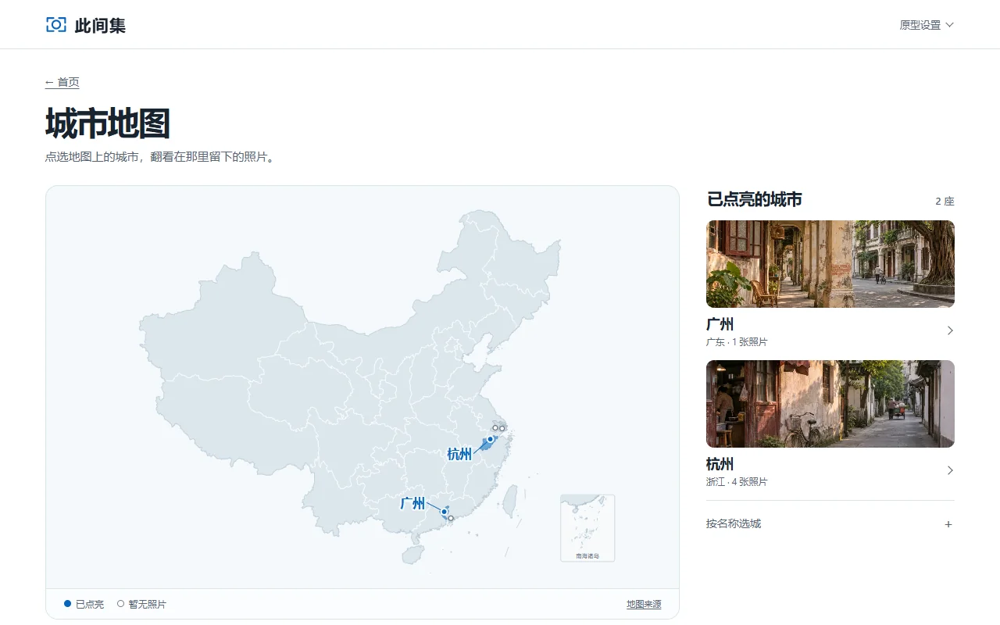
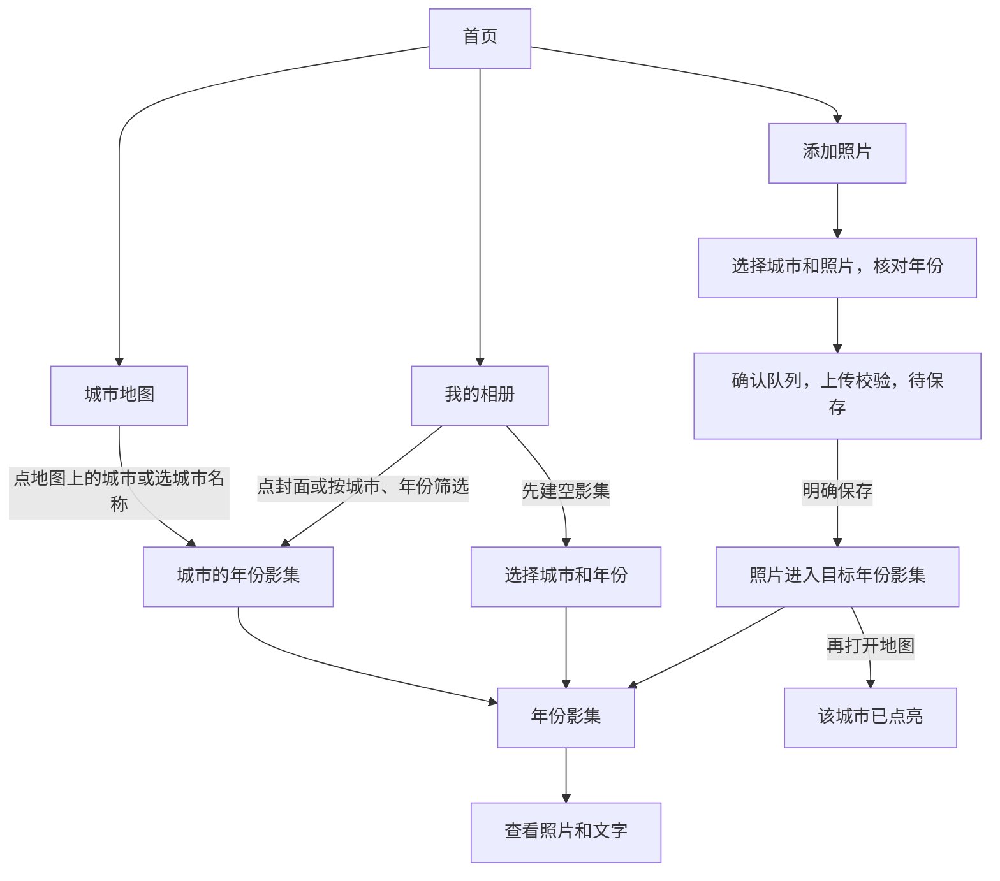
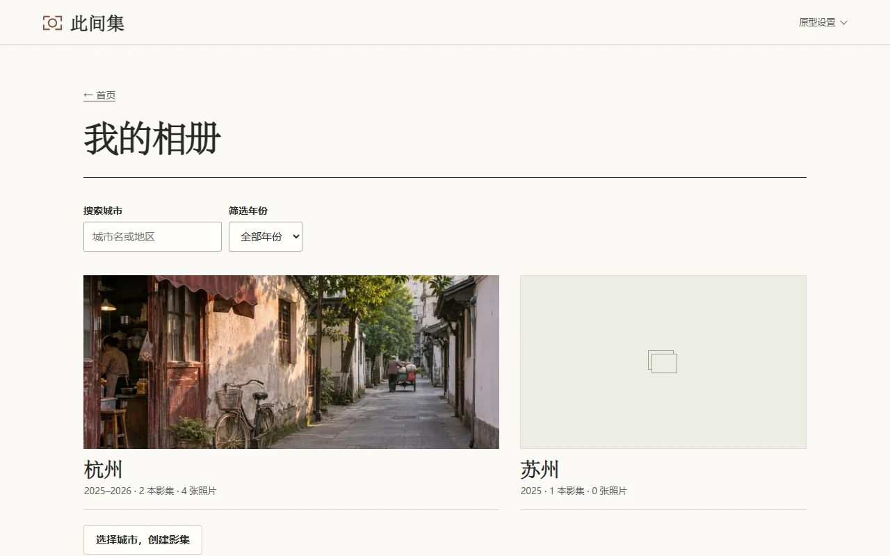
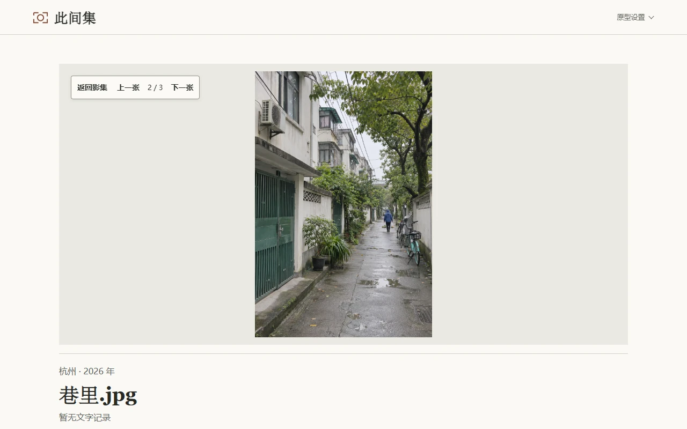

# 此间集 · 用户流程与页面原型

2026-11-27 · 前端重构第一阶段 · 原型评审稿

[打开可点击原型](prototype/index.html)。在本机用 Edge 打开后，从已登录的首页开始。示例账号用合成照片演示广州、杭州两座已点亮的城市。深圳已有空影集，可以用来体验保存第一张照片后点亮一座城市。右上角「原型设置」可切换至空账号或模拟地图失败。

## 首页通向哪些页面

| 首页入口 | 进入后看到什么 | 可以完成什么 |
| --- | --- | --- |
| **城市地图** | 中国地图、当前账号已点亮的城市和按城市名浏览的入口 | 在地图上点广州，直接翻广州的年份影集。 |
| **我的相册** | 当前账号的城市相册，附封面、年份和照片数 | 认封面、搜城市或筛年份，直接去想看的影集。 |
| **添加照片** | 选城页，选好城市后进入照片与年份核对页 | 把一张新照片存到指定城市和年份。可以从零影集开始。 |

地图是第一个入口。首页用白底、深色标题和少量蓝色引导点选，地图配图与街景封面帮助辨认入口。全国交互地图、城市点亮统计和相册筛选在各自的页面打开。三个入口在桌面和窄屏首屏均可操作。

| 桌面首页 | 手机首页 |
| --- | --- |
|  |  |

## 从地图回看一座城市

1. **首页 → 城市地图。** 进入这一页才加载交互地图。颜色与文字共同标出哪些城市有照片。省界用来辨认位置；同省的广州、深圳分别计算。
2. **城市地图 → 广州。** 点广州的地图标记，或从城市名单选广州，直接进入广州的年份列表。在手机上查看地理位置相近的几座城市时，可以用名单准确选城。
3. **广州 → 2026 年 → 骑楼街口.jpg。** 先看到年份封面和照片数，打开照片后可看完整画面和文字。按返回或 Esc 关闭单张，继续逐级返回到广州、城市地图和首页。经「我的相册」进入时，逐级返回相册列表。
4. **对照广州和深圳。** 示例账号在广州有已保存照片，广州点亮。深圳只有空影集，保持未点亮。给深圳保存第一张照片后再进地图，深圳也会点亮，广州原有记录照常可见。

## 直接翻相册或添加照片

**翻相册。** 从首页点「我的相册」。可以搜索“杭州”或筛选 2026 年，打开「杭州 → 2026 年 → 街口.jpg」，再切到竖幅《巷里》。封面按卡片裁切，单张照片完整显示。左右方向键翻页，Esc 返回影集。逐级返回列表时保留原先的筛选和浏览位置。

**添加照片。** 从首页点「添加照片」，选择深圳和一张样片，填写 2026 年或勾选「未标年份」。依次执行「确认队列」「上传并校验」，看到「已校验，待保存」后选择「确认保存」。打开目标影集可以核对照片，也可以回首页，走「城市地图 → 深圳」或「我的相册 → 深圳」找到同一份记录。同城同年份复用已有影集。

| 相册浏览 | 单张照片 |
| --- | --- |
|  |  |

## 空状态、中断与返回

| 场景 | 页面行为 |
| --- | --- |
| 新账号打开地图 | 已点亮城市数为零。可以通过城市名称选城，也可以从首页添加第一张照片。 |
| 先建影集，暂时没有照片 | 「我的相册」中可以找到空影集。地图按已保存的有效照片数判断点亮状态。 |
| 上传取消、失败或待保存 | 这几个阶段都不点亮城市。上传失败可重试，只有确认保存的照片才计入城市记录。 |
| 地图仍在加载或加载失败 | 地图页提供相应提示；可离开去相册，失败后可重试。首页、文字选城和添加照片独立可用。 |
| 搜索或筛选没有结果 | 在相册列表清除筛选后可重新浏览。新账号可直接添加照片，也可以先创建空年份影集。 |
| 切换账号或刷新 | 只显示当前账号的示例资料。当前标签页刷新后保留已保存记录，未保存的操作可重新开始。 |

## 原型评审

| 走查任务 | 看什么 | 对应需求 |
| --- | --- | --- |
| 用桌面和手机分别从首页进入地图、相册、添加 | 三个入口的名称、位置和目的地清楚。封面或地图加载缓慢时，仍可以开始另外两条流程。 | AC-01、AC-02 |
| 打开地图，对比广州与深圳；再模拟地图失败并重试 | 能用地图和城市名称两种方式选城；同省两城的状态独立，出错时可恢复。 | AC-03 |
| 分别从地图和筛选后的相册打开同一城市、年份和照片，再逐级返回 | 两条路径显示同一张照片和文字，返回各自的来源。 | AC-05 |
| 用新账号创建空影集、取消一次导入，再确认保存并刷新 | 只有确认保存后城市才点亮；切换账号后只看到本人的照片和足迹。 | AC-04、AC-06、AC-07 |

原型内提供五座示例城市。合成照片只用于评审界面和流程。当前标签页保存原有演示记录；查看初始样例可另开独立浏览会话。正式城市覆盖、原图存储、服务端账号隔离和 AC-08 冷启动耗时在正式构建版验收。地图几何来源见[公共地图数据说明](../../frontend/public/map-data/NOTICE.md)，完整验收条件见[产品需求与验收标准](requirements.md)。
