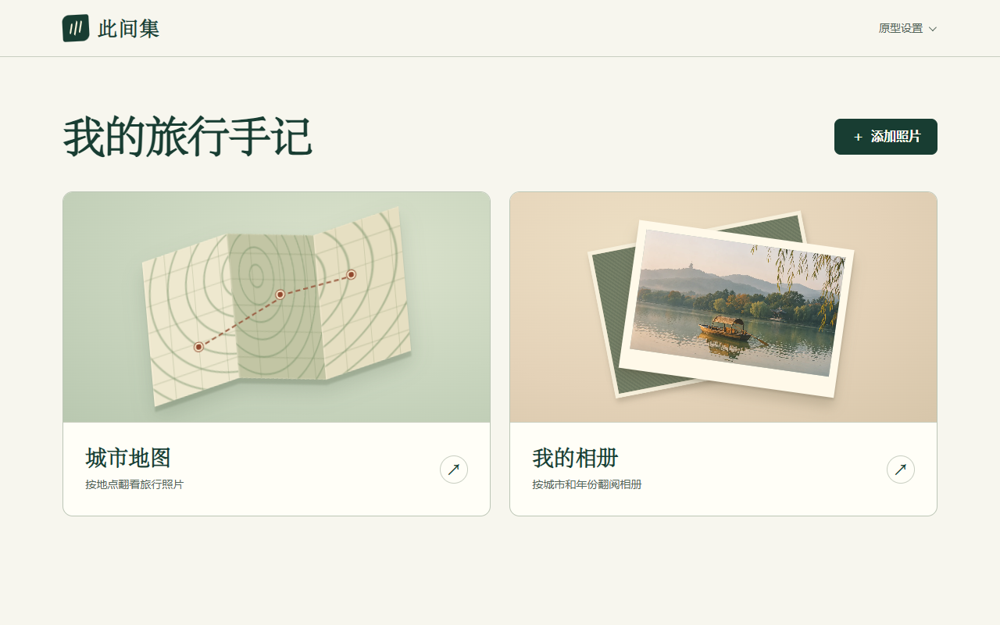
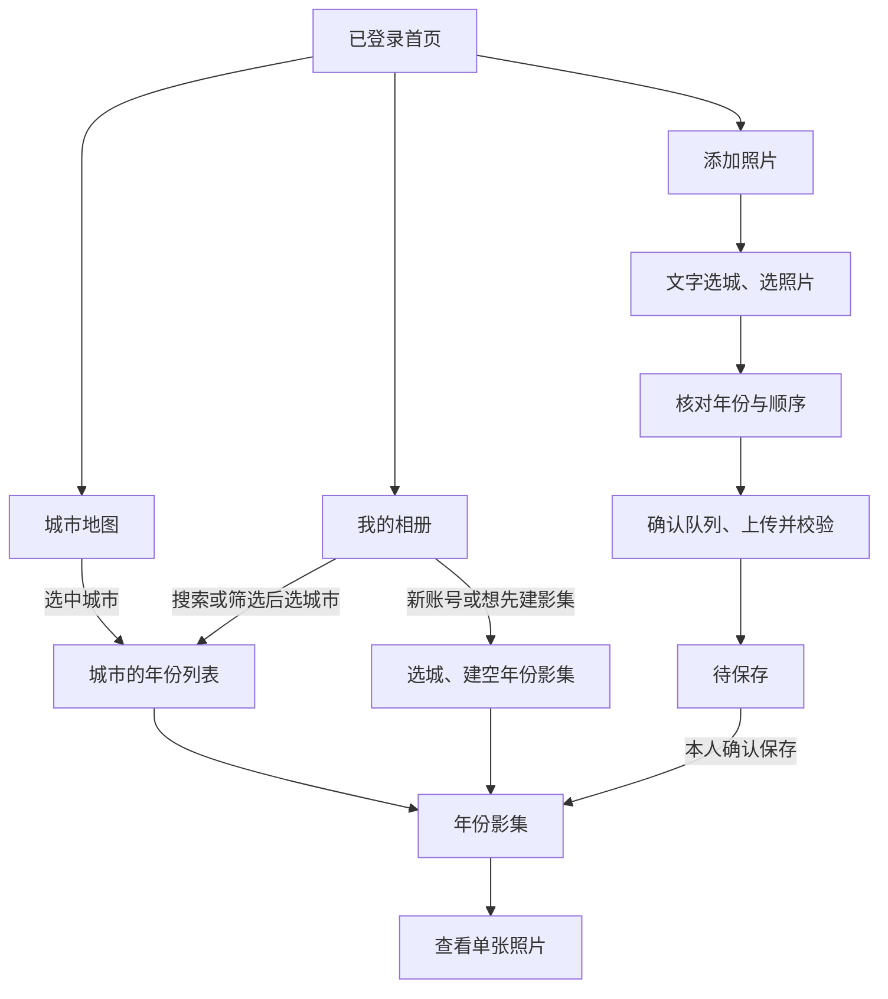

# 此间集 · 用户流程与页面原型

2026-11-24 · 前端重构第一阶段 · 原型评审稿

**[打开可点击原型](prototype/index.html)**。本机用 Edge 打开 `prototype/index.html` 即可操作，GitHub 文件页可查看源码。原型从已登录的首页开始，仅使用示例资料。右上角的「原型设置」可切换账号或模拟地图失败。

初次打开时，杭州有 2026 和 2025 两本影集，苏州只有一本空影集，上海尚无影集。湖景是为原型生成的样片。保存的演示记录随当前标签页保留，刷新或切回该账号都可继续查看。如需再次从零体验，可在新的独立浏览会话中选择「原型设置 → 切换至新账号」。

## 首页怎样选

首页提供三个入口。地图和相册是两种找照片的方式，各用一张整块可点的卡。「添加照片」按钮放在标题旁，从这里可以开始记录。地图卡上的静态折页提示用途，点击后才进入城市位置示意。正式页面的账号管理与回收站归入次级导航，本次原型的右上角菜单用于演示设置。

| 城市地图 | 我的相册 | 添加照片 |
| --- | --- | --- |
| “我在哪些城市留过照片？”选城市，进年份影集。 | “我想翻杭州那本相册。”找城市或筛年份，按封面进入。 | “我想存下刚拍的照片。”选城市和照片，核对年份并保存。 |

| 桌面 · 1280 × 800 | 窄屏 · 375 × 812 |
| --- | --- |
|  |  |

## 三条主要流程

### 从地点回看

1. 点「城市地图」进入地图页。等待时可以返回首页或直接翻相册。地图失败时可重试，切换到「我的相册」仍可用。
2. 在地图上选择城市，查看它的年份影集。已保存有效照片的城市点亮，只有空影集的城市仍可选择。
3. 打开某年份和某张照片。逐级返回时回到刚才的城市，再回到原先的地图视角。

### 从相册回看

1. 点「我的相册」，默认看到自己的城市相册。搜索城市、筛选年份，点封面看该城的年份列表。
2. 点年份，再点照片看完整画面和文字。从照片逐级返回，相册保留本次筛选和浏览位置。
3. 新账号可走「选城 → 创建空影集」；已有影集但筛选无匹配时，清除筛选即可回到完整列表。两种空状态分别提供对应操作。

### 保存第一张照片

1. 从「原型设置」切换至初始为空的新账号，在首页点「添加照片」，选择杭州。用户可以直接走这条路，无需先建相册。
2. 选择「湖畔.jpg」，手动填写 2026，也可以勾选「未标年份」。依次点「确认队列」「上传并校验」，界面显示「已校验，待保存」。原型每次使用一张样片，正式批量导入时还要核对照片顺序。
3. 确认保存，打开目标年份影集再点开原图。也可以回首页，经「我的相册 → 杭州 → 2026」找到同一张照片。重复向同城同年份添加时，沿用已有影集。

## 遇到中断时

| 情况 | 用户看到什么、下一步怎么走 |
| --- | --- |
| 地图正在加载或失败 | 等待时可以离开；失败时留在地图页重试，或直接去相册。文字选城和添加流程独立可用。 |
| 城市尚无照片 | 年份列表可以为空，也可以保留先建好的空影集。先选城市和年份，随后可添加第一张照片。 |
| 导入中途取消、上传失败 | 确认保存前，照片不计入影集。确认队列后可点「模拟上传失败」，再点「重试上传」。正式流程遇到保存结果不明时，先核对结果再决定是否重试。 |
| 关闭单张照片、逐级返回 | 先回到所属年份，再回到城市及原来的浏览入口。回看另一张照片不改变它的年份和顺序。 |
| 切换账号 | 回到当前账号的入口和资料，上一账号的城市点亮、影集和导入草稿不出现在新账号中。 |

## 评审时走哪几步

| 走查任务 | 观察点 | 对应需求 |
| --- | --- | --- |
| 在桌面和窄屏分别找地点、翻相册、存一张新照片 | 三个入口都在首屏；分别记录第一次点了哪里。用 Tab 和 Enter 再走一次。 | AC-01 |
| 让地图加载失败，再去相册；恢复后重试地图 | 等待或失败只影响地图，地图恢复后能选城。 | AC-02、AC-03 |
| 从地图和筛选后的相册分别打开同一张照片，逐级返回 | 两个入口看到同一资料，返回保留各自上下文。 | AC-05 |
| 分别尝试先建空影集和从零影集直接添加，最后切换账号 | 可以区分「校验完成」和「已保存」，保存后能重新找到照片，切换后看到本账号资料。 | AC-04、AC-06、AC-07 |

原型用少量城市和示例照片演示状态与去向。地图覆盖、真实原图上传与持久化、服务端账号隔离，以及 AC-08 的冷启动耗时，按正式构建版验收。产品规则和计时方法见[产品需求与验收标准](requirements.md)。
